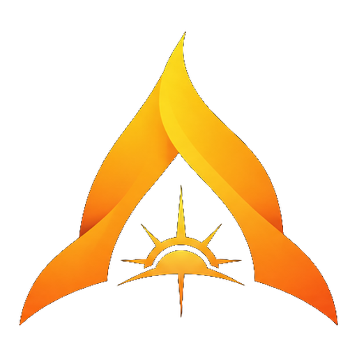
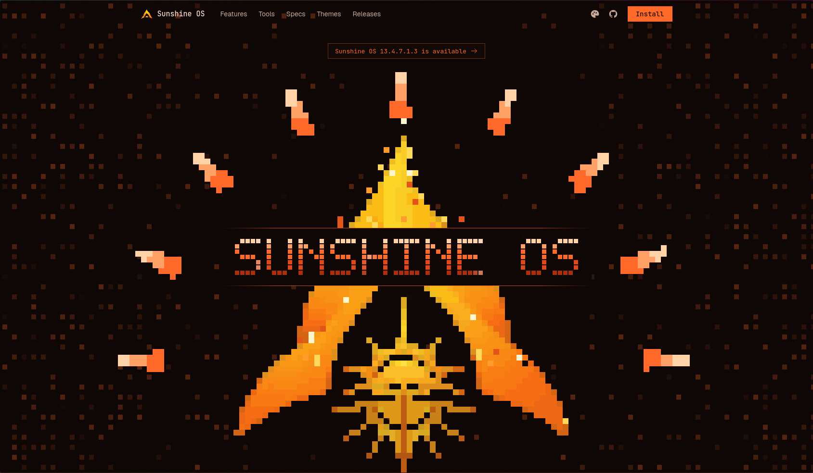
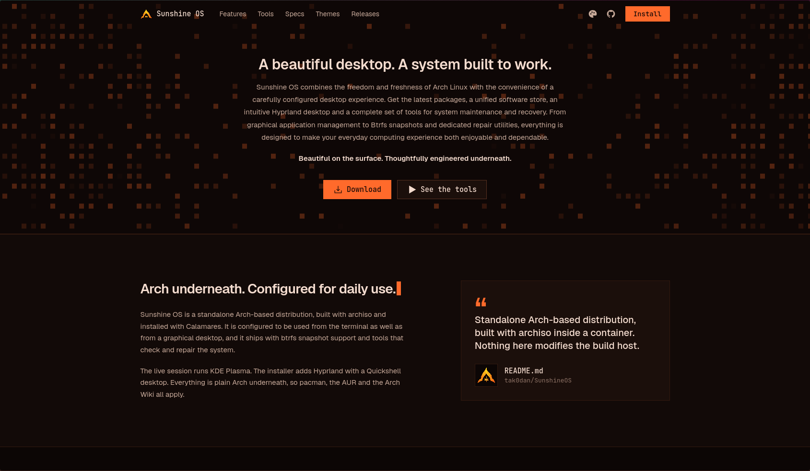
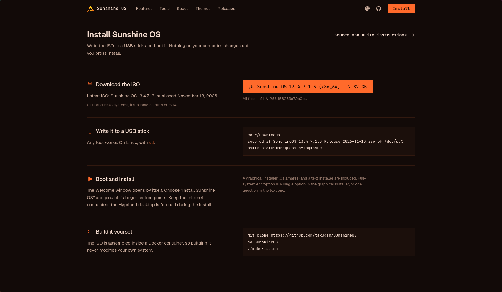
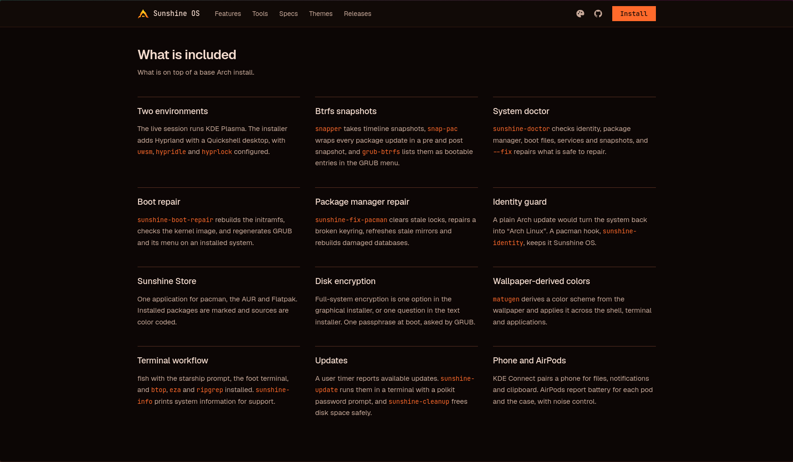
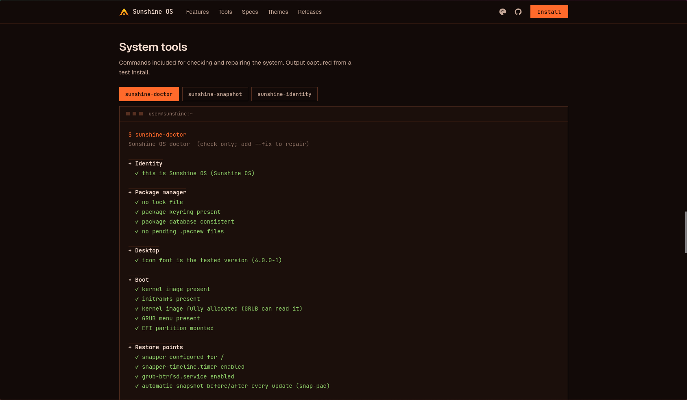
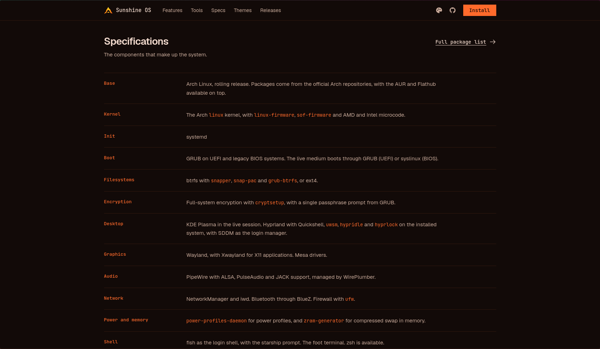
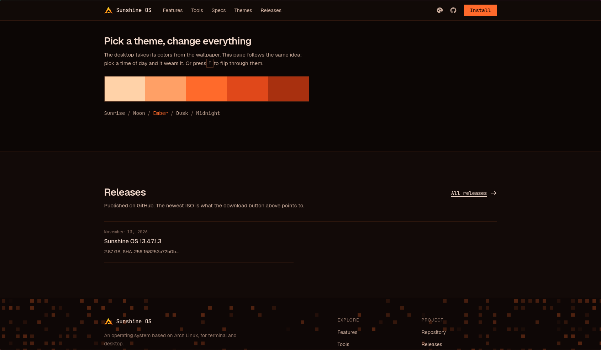
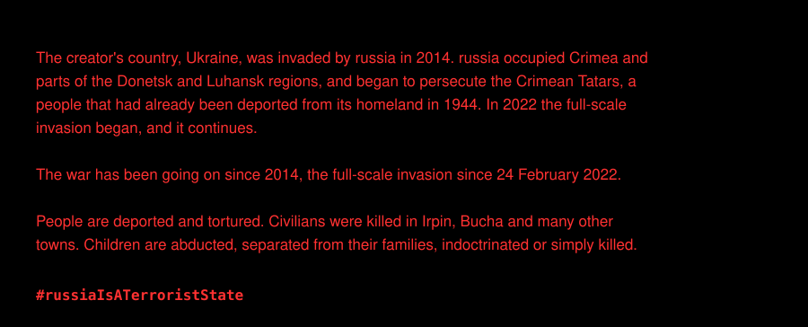

🌐 **[tak0dan.github.io/sunshineos-site](https://tak0dan.github.io/sunshineos-site/)** &nbsp;·&nbsp; English &nbsp;·&nbsp; [Українська](README.uk.md)

<div align="center">



# Sunshine OS — website

**A beautiful desktop. A system built to work.**

<a href="https://tak0dan.github.io/sunshineos-site/?download=1#install"></a>&nbsp;&nbsp;<a href="https://tak0dan.github.io/sunshineos-site/"></a>


</div>



## A beautiful desktop. A system built to work.

Sunshine OS combines the freedom and freshness of Arch Linux with the convenience of a carefully configured desktop
experience. Get the latest packages, a unified software store, an intuitive Hyprland desktop and a complete set of tools for
system maintenance and recovery.

**Beautiful on the surface. Thoughtfully engineered underneath.**



## Install

The download button reads `release.json`, so the file name, version, architecture and size on the button always match the
newest published ISO. The page also shows the USB command with the real file name, and the SHA-256 of the image.



## What is included

Two desktop environments (KDE Plasma and Hyprland), Btrfs snapshots, the Sunshine Store, wallpaper-derived colours, boot and
package-manager repair, disk encryption, and more.



## System tools

Commands for checking and repairing the system: `sunshine-doctor`, `sunshine-snapshot`, `sunshine-identity`,
`sunshine-boot-repair`, `sunshine-fix-pacman`, `sunshine-cleanup`, `sunshine-update`.



## Specifications



## Themes

The page takes its colours from the same palette as the desktop. Press `T` to switch between Sunrise, Noon, Ember, Dusk
and Midnight.



## Languages

The page exists in English (`index.html`) and Ukrainian (`uk/index.html`), with a switch in the navigation. The Ukrainian page is generated, not edited by hand:

```sh
python3 tools/build-uk.py   # index.html + the translation table -> uk/index.html
```

Edit `index.html`, add the translation of any new text to `tools/build-uk.py`, run the script and commit both pages.

## Download links

`https://tak0dan.github.io/sunshineos-site/?download=1#install` opens the page and starts the ISO download from it, so the visitor stays on the site. The Sunshine OS repository's README uses this link for its Download button. Add `uk/` before `?` for the Ukrainian page.

## Repository layout

| Path | Purpose |
| --- | --- |
| `index.html` | The English page: markup, styles and scripts |
| `uk/index.html` | The Ukrainian page, generated by `tools/build-uk.py` |
| `release.json` | Published releases; the button (version, architecture, size), the USB command and the Releases list are generated from it |
| `assets/` | Pixel logo sprite sheets, wallpapers, screenshots and README images |
| `tools/build-uk.py` | Builds the Ukrainian page |

## Releasing

`tools/release-github.sh` in the [Sunshine OS repository](https://github.com/tak0dan/SunshineOS) uploads the ISO and adds an
entry to `release.json`. Push that file and the page shows the new version without any edit to `index.html`.

## Run locally

```sh
python3 -m http.server 8000
# open http://localhost:8000
```

---

## Stay with Ukraine

[](https://unitedhelpukraine.org/how-you-can-help/)



[Bucha](https://en.wikipedia.org/wiki/Bucha_massacre) · [Irpin](https://en.wikipedia.org/wiki/Battle_of_Irpin) · [Crimea](https://en.wikipedia.org/wiki/Annexation_of_Crimea_by_the_Russian_Federation) · [Donetsk and Luhansk](https://en.wikipedia.org/wiki/War_in_Donbas) · [Crimean Tatars](https://en.wikipedia.org/wiki/Deportation_of_the_Crimean_Tatars) · [Abducted children](https://en.wikipedia.org/wiki/Deportation_of_Ukrainian_children_to_Russia) · [War crimes](https://en.wikipedia.org/wiki/Russian_war_crimes) · [The full-scale invasion](https://en.wikipedia.org/wiki/Russian_invasion_of_Ukraine)

<p align="center"><b>#StayWithUkraine</b> &nbsp;·&nbsp; <b>#russiaIsATerroristState</b></p>
