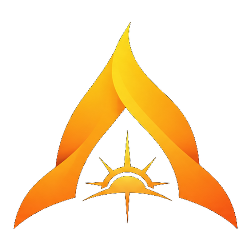
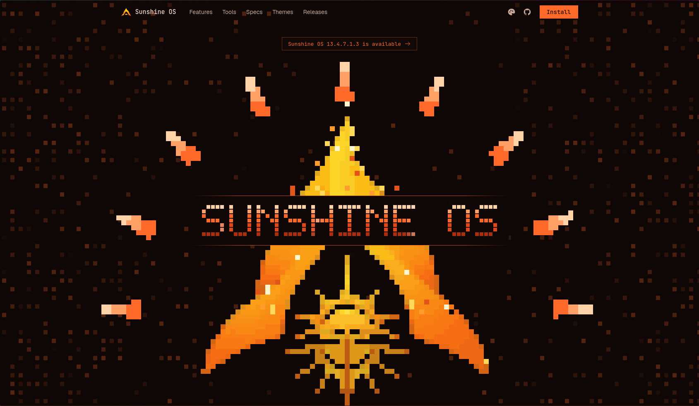
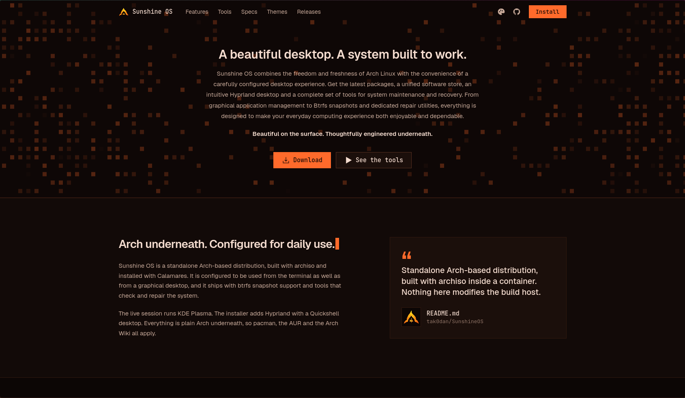
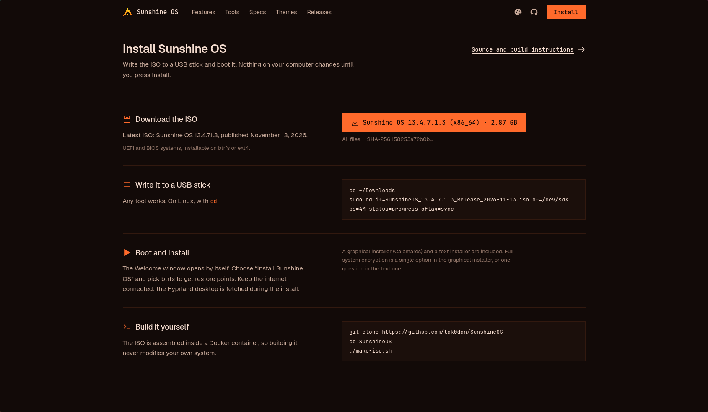
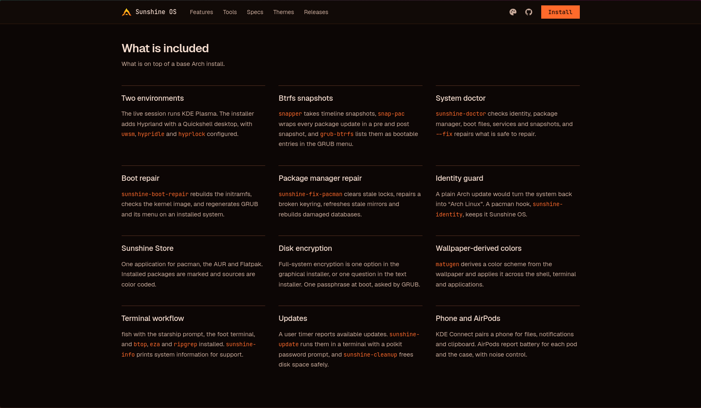
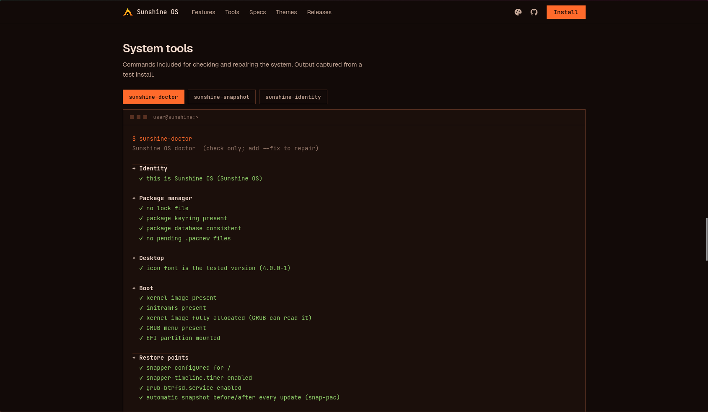
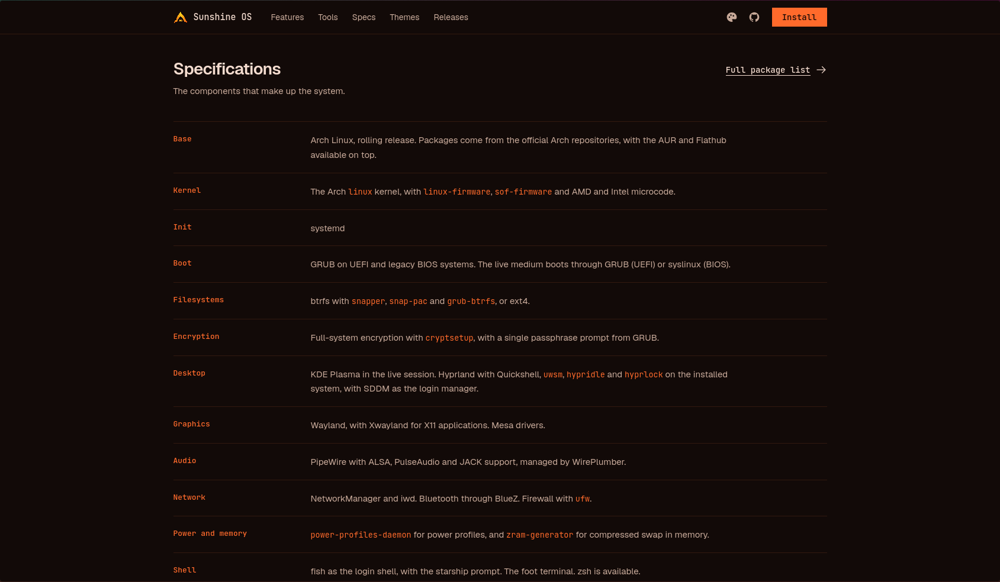
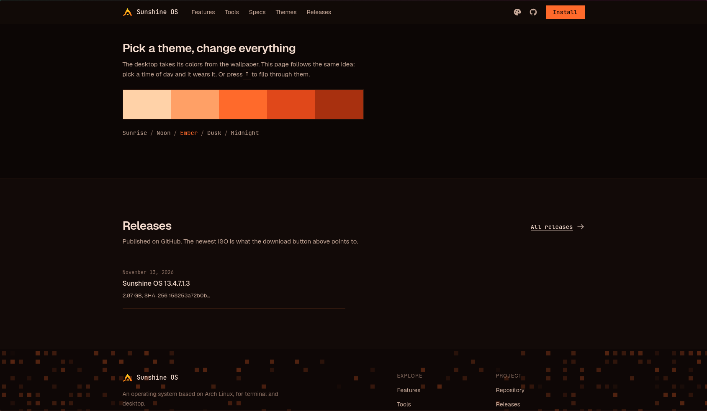
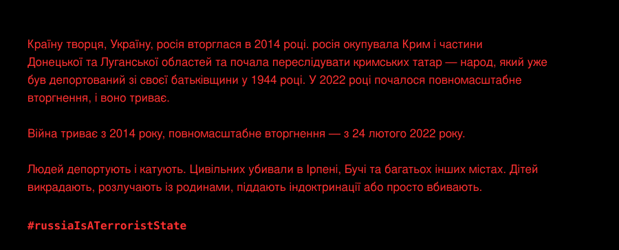

🌐 **[tak0dan.github.io/sunshineos-site/uk](https://tak0dan.github.io/sunshineos-site/uk/)** &nbsp;·&nbsp; [English](README.md) &nbsp;·&nbsp; Українська

<div align="center">



# Sunshine OS — вебсайт

**Красива стільниця. Система, створена для роботи.**

<a href="https://tak0dan.github.io/sunshineos-site/uk/?download=1#install"></a>&nbsp;&nbsp;<a href="https://tak0dan.github.io/sunshineos-site/uk/"></a>


</div>



## Красива стільниця. Система, створена для роботи.

Sunshine OS поєднує свободу й свіжість Arch Linux із зручністю ретельно налаштованої стільниці. Найновіші пакети, єдиний магазин програм, інтуїтивна стільниця Hyprland і повний набір засобів для обслуговування та відновлення системи.

**Красива назовні. Продумана всередині.**



## Встановлення

Кнопка завантаження читає `release.json`, тож назва файлу, версія, архітектура й розмір на кнопці завжди відповідають найновішому опублікованому ISO. Сторінка також показує команду для флешки з реальною назвою файлу та SHA-256 образу.



## Що входить

Два середовища стільниці (KDE Plasma і Hyprland), знімки Btrfs, Sunshine Store, кольори зі шпалер, відновлення завантаження та менеджера пакетів, шифрування диска та інше.



## Системні інструменти

Команди для перевірки та відновлення системи: `sunshine-doctor`, `sunshine-snapshot`, `sunshine-identity`, `sunshine-boot-repair`, `sunshine-fix-pacman`, `sunshine-cleanup`, `sunshine-update`.



## Складові системи



## Теми

Сторінка бере кольори з тієї самої палітри, що й стільниця. Натискайте `T`, щоб перемикати Світанок, Полудень, Жар, Присмерк і Північ.



## Мови

Сторінка існує англійською (`index.html`) та українською (`uk/index.html`), з перемикачем у навігації. Українська сторінка генерується, а не редагується вручну:

```sh
python3 tools/build-uk.py   # index.html + таблиця перекладу -> uk/index.html
```

Змініть `index.html`, додайте переклад нового тексту в `tools/build-uk.py`, запустіть скрипт і закомітьте обидві сторінки.

## Посилання для завантаження

`https://tak0dan.github.io/sunshineos-site/?download=1#install` відкриває сторінку й починає завантаження ISO з неї, тож відвідувач залишається на сайті. Це посилання використовує кнопка «Завантажити» в README репозиторію Sunshine OS. Для української сторінки додайте `uk/` перед `?`.

## Структура репозиторію

| Шлях | Призначення |
| --- | --- |
| `index.html` | Англійська сторінка: розмітка, стилі та скрипти |
| `uk/index.html` | Українська сторінка, згенерована `tools/build-uk.py` |
| `release.json` | Опубліковані випуски; кнопка (версія, архітектура, розмір), команда для флешки та список випусків генеруються з нього |
| `assets/` | Спрайти піксельного логотипа, шпалери, знімки екрана та зображення для README |
| `tools/build-uk.py` | Збирає українську сторінку |

## Випуск

`tools/release-github.sh` у [репозиторії Sunshine OS](https://github.com/tak0dan/SunshineOS) завантажує ISO та додає запис у `release.json`. Надішліть цей файл — і сторінка покаже нову версію без жодних змін в `index.html`.

## Запуск локально

```sh
python3 -m http.server 8000
# відкрийте http://localhost:8000
```

---

## Stay with Ukraine — залишайтеся з Україною

[](https://unitedhelpukraine.org/how-you-can-help/)



[Буча](https://uk.wikipedia.org/wiki/Бучанська_різанина) · [Ірпінь](https://uk.wikipedia.org/wiki/Битва_за_Ірпінь) · [Крим](https://uk.wikipedia.org/wiki/Анексія_Криму_(2014)) · [Донецьк і Луганськ](https://uk.wikipedia.org/wiki/Війна_на_сході_України) · [Кримські татари](https://uk.wikipedia.org/wiki/Депортація_кримських_татар) · [Викрадені діти](https://uk.wikipedia.org/wiki/Викрадення_дітей_під_час_російського_вторгнення_в_Україну) · [Воєнні злочини](https://uk.wikipedia.org/wiki/Воєнні_злочини_Росії) · [Повномасштабне вторгнення](https://uk.wikipedia.org/wiki/Російське_вторгнення_в_Україну_(з_2022))

<p align="center"><b>#StayWithUkraine</b> &nbsp;·&nbsp; <b>#russiaIsATerroristState</b></p>
